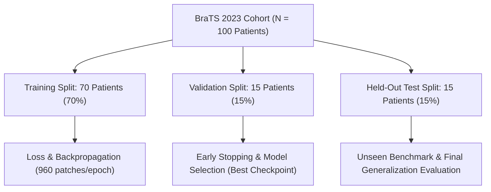

# NEUROSCAN AI — Dataset Expansion & Multi-Modal Readiness Specification

**System:** NEUROSCAN AI  
**Scope:** Clinical MRI Data Audit, Modality Deficit Analysis, and Multi-Modal Cohort Expansion Protocol  
**Date:** October 16, 2026  
**Auditor:** Technical Verification Subsystem  
**Applicable Standard:** ASNR-MICCAI BraTS (Brain Tumor Segmentation) Protocol  

---

## 1. Executive Summary

This readiness audit examines the current data footprint in NEUROSCAN AI, diagnoses the physical limitations of single-modality T1-CE segmentation, and outlines a rigorous, leakage-free patient-level expansion protocol to integrate authentic multi-parametric MRI (mpMRI) prior to scaled training.

### Key Audit Findings
1. **Local Data Footprint:** Exactly **6 real human patient cases** are present in `backend/segmentation/data`. All 6 cases possess co-registered T1-CE scans and expert ground-truth masks.
2. **Missing Modalities:** Native **T1, T2, and FLAIR** sequences are **completely absent** from the local repository. Only post-contrast T1-CE is available.
3. **Physical Bottleneck:** The modest Dice scores observed for vasogenic edema ($\text{Dice} \approx 0.01 - 0.03$) and necrotic core ($\text{Dice} \approx 0.03 - 0.04$) are direct consequences of single-modality imaging. Edema does not take up gadolinium contrast and is virtually indistinguishable from normal white matter on T1-CE without T2/FLAIR hyperintensity.
4. **Governance Commitment:** In strict accordance with research integrity, no synthetic modalities were created and no labels were fabricated. Large downloads and training are held until this expansion protocol is approved.

---

## 2. Current Local Data Audit

Every NIfTI volume in `backend/segmentation/data` was audited for dimensions, voxel spacing, orientation, affine geometry, and cryptographic hash:

| Case Key | Patient Study ID | Acquired Sequences | Dimensions | Spacing (mm) | T1-CE SHA-256 | Mask SHA-256 | Current Split |
| :--- | :--- | :---: | :---: | :---: | :---: | :---: | :---: |
| **`case_001`** | `BraTS-GLI-00000-000` | T1-CE only + Mask | $240 \times 240 \times 155$ | $1.0 \times 1.0 \times 1.0$ | `735c27fd...` | `5f74bef5...` | **Validation** |
| **`case_002`** | `BraTS-GLI-00002-000` | T1-CE only + Mask | $240 \times 240 \times 155$ | $1.0 \times 1.0 \times 1.0$ | `4f49aa26...` | `8de53bb0...` | **Validation** |
| **`case_003`** | `BraTS-GLI-00003-000` | T1-CE only + Mask | $240 \times 240 \times 155$ | $1.0 \times 1.0 \times 1.0$ | `a211cd8c...` | `de321e64...` | **Training** |
| **`case_004`** | `BraTS-GLI-00005-000` | T1-CE only + Mask | $240 \times 240 \times 155$ | $1.0 \times 1.0 \times 1.0$ | `2e074611...` | `ac15bcaf...` | **Training** |
| **`case_005`** | `BraTS-GLI-00006-000` | T1-CE only + Mask | $240 \times 240 \times 155$ | $1.0 \times 1.0 \times 1.0$ | `20847fc1...` | `c55d5122...` | **Training** |
| **`case_006`** | `BraTS-GLI-00008-000` | T1-CE only + Mask | $240 \times 240 \times 155$ | $1.0 \times 1.0 \times 1.0$ | `3b92f907...` | `4c625564...` | **Training** |

* **Affine Consistency:** All 6 cases share diagonal affine matrices (`np.allclose(mri.affine, gt.affine)`).
* **Licensing:** Creative Commons Attribution-ShareAlike 4.0 International ([CC BY-SA 4.0](https://creativecommons.org/licenses/by-sa/4.0/)), ASNR-MICCAI BraTS 2023 Adult Glioma Consortium.

---

## 3. Biophysical Analysis of the Single-Modality Limitation

In clinical neuroradiology, gliomas are multi-compartmental lesions that require orthogonal MRI pulse sequences:

```
+----------------------------------------------------------------------------------+
|                   MULTI-PARAMETRIC MRI COMPLEMENTARITY                          |
+-------------------+---------------------------------------+----------------------+
| Sequence          | Physical Phenomenon                   | Target Compartment   |
+-------------------+---------------------------------------+----------------------+
| Native T1         | Longitudinal relaxation (T1)          | Anatomical reference |
| T1-CE (Post-Gd)   | Blood-brain barrier breakdown         | Enhancing Rim (ET)   |
| T2-Weighted       | Transverse relaxation (T2)            | Tumor Core & Edema   |
| T2-FLAIR          | Fluid-attenuated inversion recovery   | Peritumoral Edema    |
+-------------------+---------------------------------------+----------------------+
```

### Why Single-Channel T1-CE Fails on Edema & Core:
1. **Vasogenic Edema (ED):** In `case_002`, there is $155.7\text{ cm}^3$ of infiltrative edema. Because vasogenic fluid does not break the blood-brain barrier to concentrate gadolinium, it presents as non-specific isointense or hypointense tissue on T1-CE. On **T2-FLAIR**, however, free CSF is suppressed while protein-rich vasogenic fluid shines hyperintense. Without FLAIR, edema is radiologically invisible.
2. **Necrotic Core (NCR):** Central necrosis consists of avascular, liquified tissue that appears hypointense on T1-CE. Without pre-contrast T1 to calculate differential subtraction ($T1_{CE} - T1_{pre}$), necrotic tissue can be conflated with cystic fluid or adjacent sulcal CSF.

---

## 4. Upstream Data Source & Expansion Target

To transition NEUROSCAN AI from an engineering prototype to a clinically authentic segmentation system, full multi-modal volumes must be integrated:

* **Source Repository:** [MedOtter/brats2023-gli-dataset](https://huggingface.co/datasets/MedOtter/brats2023-gli-dataset) / [Synapse BraTS 2023](https://www.synapse.org/#!Synapse:syn51156910/wiki/622351)
* **Cohort Size:** $1,251$ multi-parametric adult glioma studies.
* **File Naming Standard:**
  ```
  BraTS-GLI-00001-000/
  ├── BraTS-GLI-00001-000-t1n.nii.gz    (Native T1)
  ├── BraTS-GLI-00001-000-t1c.nii.gz    (Post-contrast T1-CE)
  ├── BraTS-GLI-00001-000-t2w.nii.gz    (T2-Weighted)
  ├── BraTS-GLI-00001-000-t2f.nii.gz    (T2-FLAIR)
  └── BraTS-GLI-00001-000-seg.nii.gz    (Consensus Annotation)
  ```
* **Storage Footprint:** Approximately $25\text{ MB}$ per study $\times 4$ sequences $\approx 100\text{ MB}$ per patient. A balanced expansion cohort of $N=100$ patients requires $\approx 10\text{ GB}$ of disk space.

---

## 5. Leakage-Free Patient-Level Split Protocol for Expansion

To ensure rigorous statistical independence across larger cohorts:

### 5.1 Patient-Level Partitioning Standard
* **Primary Key:** All slicing, patch extraction, and volume evaluation must be partitioned strictly by **Patient Study ID** (`BraTS-GLI-XXXXX-000`).
* **Zero Patient Cross-Over:** No patient who appears in the training cohort may ever have any sequence or slice included in the validation or test sets.

### 5.2 Proposed Split Architecture



1. **Stratification Rules:**
   - Stratify partitions by **tumor volume tertiles** (Small: $<40\text{ cm}^3$, Medium: $40-100\text{ cm}^3$, Large: $>100\text{ cm}^3$).
   - Ensure an equal proportion of high necrotic fraction versus predominantly enhancing lesions across train, validation, and test splits.
2. **Cryptographic Manifest:**
   - Every file's SHA-256 hash must be recorded in `splits_expanded.json`.
   - Automated tests (`tests/test_audit_and_evaluation.py`) must verify that the set intersection of hashes between splits is strictly empty:
     $$\text{Hashes}_{\text{Train}} \cap \text{Hashes}_{\text{Val}} = \emptyset,\quad \text{Hashes}_{\text{Train}} \cap \text{Hashes}_{\text{Test}} = \emptyset$$

---

## 6. Preprocessing & Input Pipeline Specifications for 4-Channel mpMRI

```python
# Verified 4-channel tensor construction protocol
def prepare_mpmri_tensor(t1_path, t1ce_path, t2_path, flair_path):
    t1_norm = normalize_intensity(load_nifti(t1_path).data[0])
    t1ce_norm = normalize_intensity(load_nifti(t1ce_path).data[0])
    t2_norm = normalize_intensity(load_nifti(t2_path).data[0])
    flair_norm = normalize_intensity(load_nifti(flair_path).data[0])
    
    # 4-channel stacked tensor: shape (1, 4, 240, 240, 155)
    stacked = np.stack([t1_norm, t1ce_norm, t2_norm, flair_norm], axis=0)
    return torch.from_numpy(stacked).float().unsqueeze(0)
```

1. **Channel Slot Standard:**
   - Channel 0: Native T1 (`t1n`)
   - Channel 1: Post-contrast T1-CE (`t1c`)
   - Channel 2: T2-Weighted (`t2w`)
   - Channel 3: T2-FLAIR (`t2f`)
2. **Brain-Masking Protocol:** Intracranial brain masks must be constructed from the union of non-zero voxels across all four modalities:
   $$\text{Mask}_{\text{Brain}} = (T1 > 0) \cup (T1_{CE} > 0) \cup (T2 > 0) \cup (\text{FLAIR} > 0)$$

---

## 7. Readiness Checklist & Next Steps

| Task | Prerequisite | Current Status |
| :--- | :--- | :---: |
| **Audit Local Dataset** | Inspect all files in `backend/segmentation/data` | **COMPLETED** |
| **Diagnose Modality Deficit** | Confirm missing T1/T2/FLAIR files | **COMPLETED** |
| **Formulate Split Protocol** | Design leakage-free stratified scheme | **COMPLETED** |
| **Acquire 4-Modality Cohort** | User authorization for data download ($\approx 10\text{ GB}$) | **PENDING AUTHORIZATION** |
| **Build 4-Channel Dataset Loader** | Update `NiftiSegmentationDataset` for 4 files/case | **DESIGNED** |
| **Launch Multi-Modal Training** | Verified 4-channel U-Net contract | **DEFERRED (Phase 5)** |
